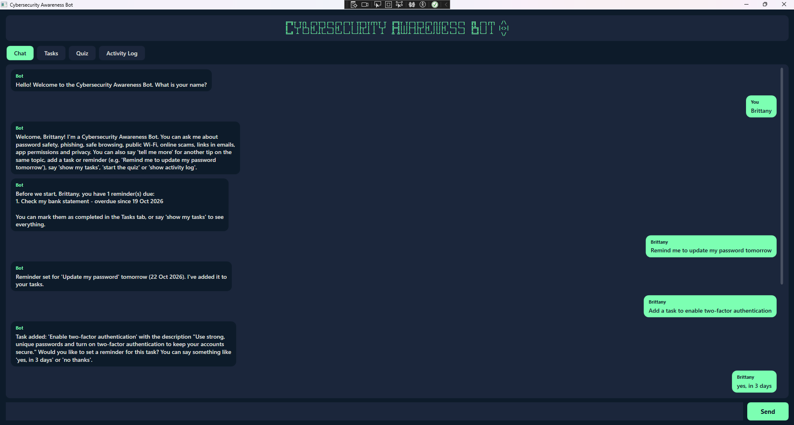
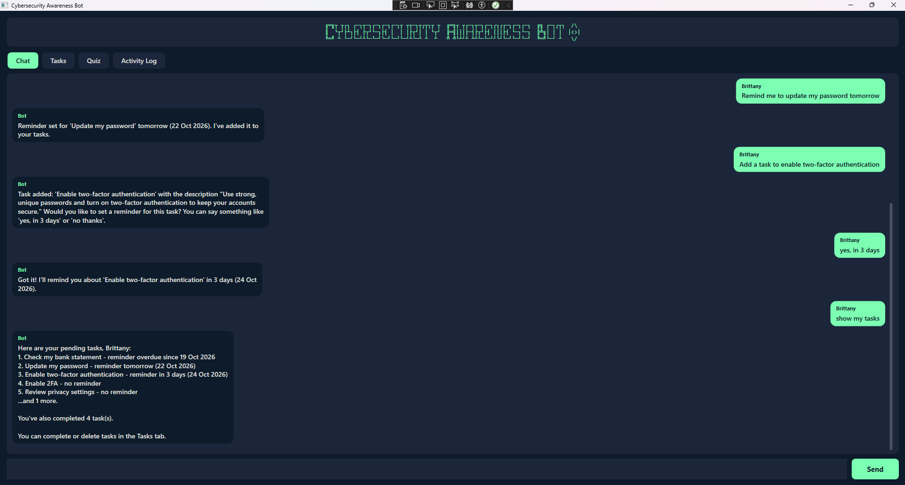
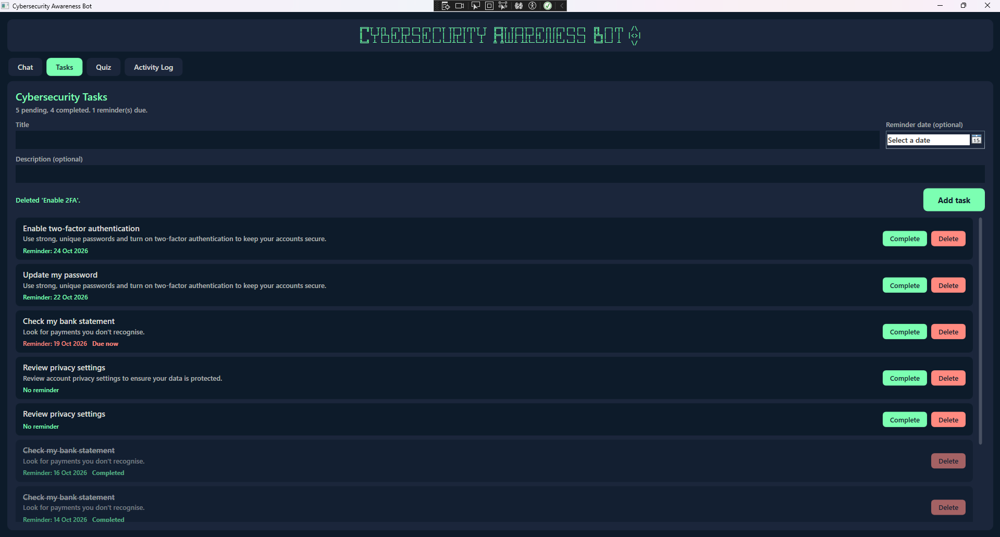
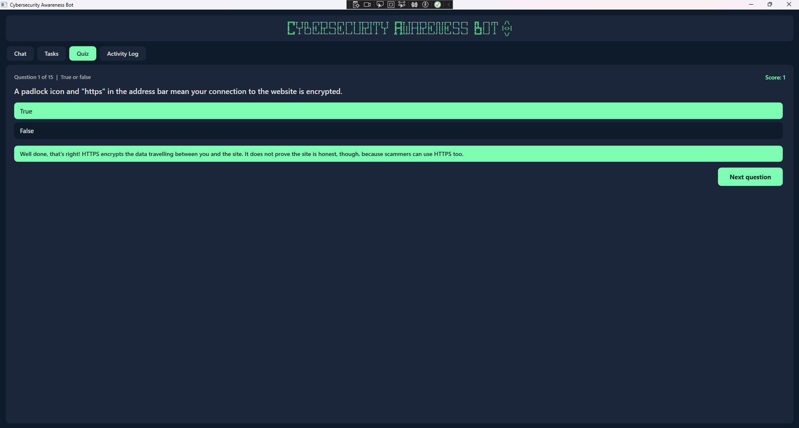
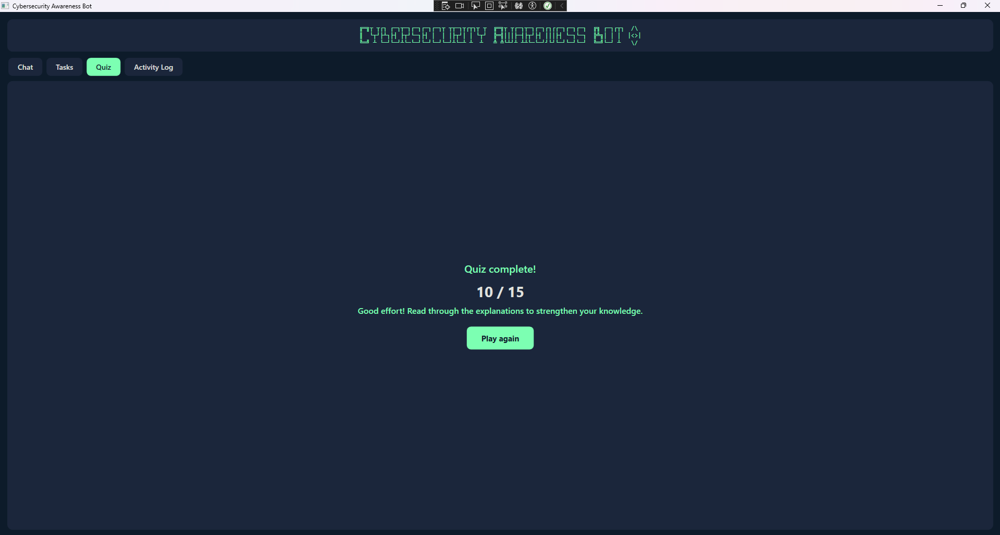
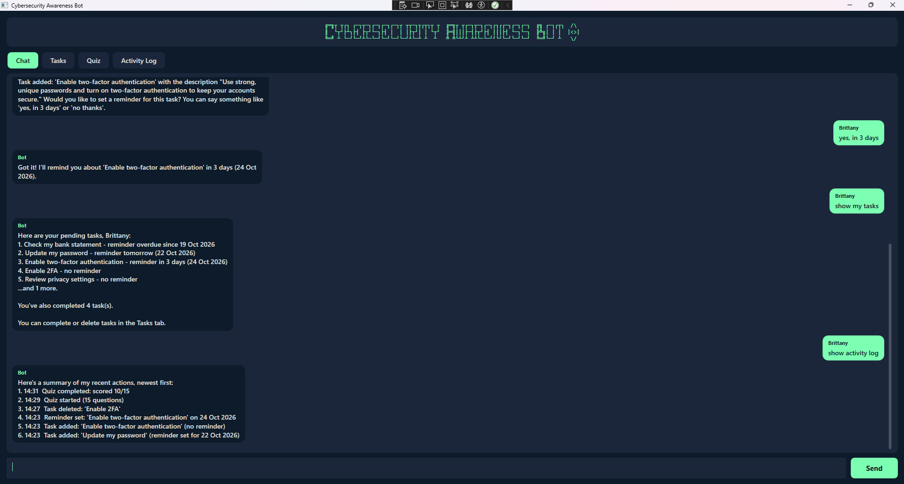
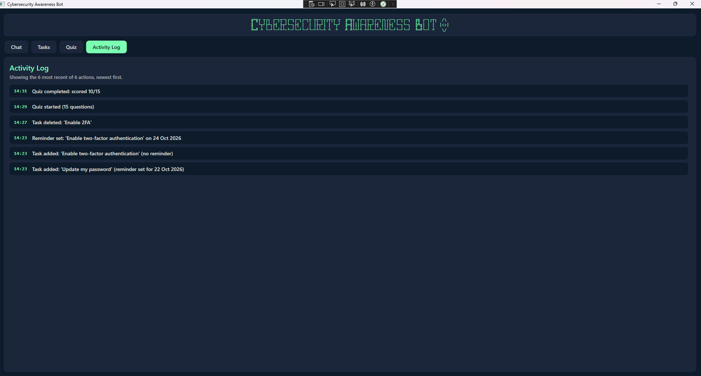
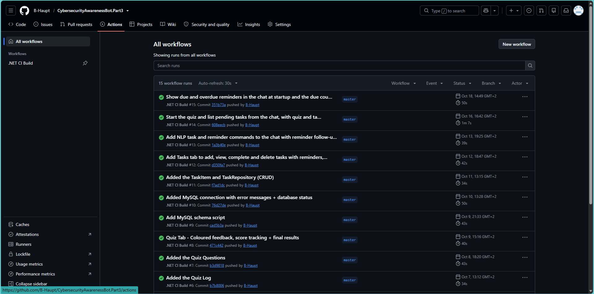

# Cybersecurity Awareness Bot - Part 3 (POE)

This is a C# WPF application built for my POE assignment for Programming 2A. It is a chatbot that helps users stay safe online by sharing cybersecurity tips, keeping track of cybersecurity tasks and reminders, testing their knowledge with a quiz, and keeping a log of everything it has done.
 
Part 3 builds on the finished Part 2 chatbot ([github.com/B-Haupt/CybersecurityAwarenessBot.Part2](https://github.com/B-Haupt/CybersecurityAwarenessBot.Part2)). Everything from Parts 1 and 2 still works: the voice greeting, the ASCII art, the personalised chat, keyword recognition, random tips, memory, sentiment detection and follow-up questions. Part 3 adds four new features, all inside the same window:
 
1. **Task assistant with reminders**, saved in a MySQL database
2. **Cybersecurity quiz** with 15 questions
3. **NLP simulation**, so tasks, reminders and the quiz can be requested in everyday language from the chat
4. **Activity log** that records the chatbot's actions and can be viewed in the chat or in its own tab


## Student

- **Name:** Brittany Haupt
- **Student number:** ST10500773
- **Module:** PROG6221 Programming 2A

## Video Presentation

YouTube link: 

## Requirements

- Can only be run on Windows, because `System.Media.SoundPlayer` only works on Windows.
- Visual Studio 2022 with the .NET desktop development workload, or the .NET 8 SDK.
- MySQL Server 8.x and MySQL Workbench (installed together with the MySQL Installer from dev.mysql.com/downloads/installer). The project was tested with MySQL 8.4.
- An internet connection the first time you build, so Visual Studio can download the MySqlConnector NuGet package. This happens automatically.

## Setup
 
### 1. Set up the database (once)
 
1. Make sure the **MySQL80** (or **MySQL84**) service is running. You can check in Windows **Services**.
2. Open **MySQL Workbench** and connect to your local server with your root account.
3. Go to **File > Open SQL Script** and open `CybersecurityAwarenessBot.Part3/Database/schema.sql`.
4. Click the **lightning bolt** to run the whole script.
The script creates:
 
- the `cybersecurity_bot` database
- the `tasks` table (id, title, description, reminder date, completed flag and the date it was created)
- a login called `cyberbot_app` that can only read and change rows in this one database
The chatbot connects with `cyberbot_app`, so your root password is never stored in the code. The script is safe to run again, because nothing is created twice and existing tasks are kept.
 
### 2. Run the chatbot
 
1. Clone the repository:
```
   git clone https://github.com/B-Haupt/CybersecurityAwarenessBot.Part3.git
```
2. Open `CybersecurityAwarenessBot.Part3.sln` in Visual Studio 2022.
3. Press **Ctrl+F5** to build and run.
If MySQL isn't running or the script hasn't been run, the chatbot still opens. The Tasks tab and the chat explain what to do instead of the program crashing.
 

## How to Use


When the program starts, it plays the voice greeting and shows the ASCII art logo, then asks for your name. If any of your reminders are due today or overdue, the chatbot lists them straight after welcoming you.
 
The window has four tabs: **Chat**, **Tasks**, **Quiz** and **Activity Log**.

### Chat
 
Ask about any of these topics: password safety, phishing, safe browsing, public Wi-Fi, privacy, online scams, links in emails and app permissions. You can also say:
 
| Type something like | What happens |
|---|---|
| `How do I make a strong password?` | A tip on the topic. Ask again for a different tip. |
| `Tell me more` / `What else?` | Another tip on the topic you're already discussing |
| `I'm interested in privacy` | The chatbot remembers your favourite topic and refers back to it later |
| `I'm worried about scams` | A supportive message, followed by a tip |
| `What can I ask?` | A list of everything the chatbot can do |
| `Remind me to update my password tomorrow` | Adds a task with a reminder for tomorrow |
| `Add a task to enable two-factor authentication` | Adds a task, then asks whether you want a reminder |
| `Yes, in 3 days` / `No thanks` | Answers the reminder question |
| `Show my tasks` / `What's on my to-do list?` | Lists your pending tasks, soonest reminder first |
| `Start the quiz` / `Quiz me` | Opens the Quiz tab and starts a game |
| `Show activity log` / `What have you done for me?` | Shows the 10 most recent actions |
| `Show more` | Shows the next 10 actions |
| `Bye` | A farewell message |
 
### Tasks
 
- Type a **title**, an optional **description** and an optional **reminder date**, then click **Add task**.
- Each task appears as a card showing its title, description, reminder and status.
- Click **Complete** to mark a task as done, or **Delete** to remove it (you're asked to confirm first).
- Tasks with a reminder due today or earlier show **Due now** in red, and the heading shows how many are due.
- Tasks added in the chat appear here straight away, and everything is saved in MySQL, so your tasks are still there the next time you open the program.

### Quiz
 
- Click **Start quiz**, or say "start the quiz" in the chat.
- There are 15 questions, a mix of multiple choice and true/false, covering phishing, passwords, safe browsing, social engineering, public Wi-Fi, privacy, app permissions and scams.
- Questions are shown one at a time in a new order each game. After each answer, the chatbot says whether you were right or wrong and explains why.
- Your score is shown throughout, and the final screen gives feedback based on your result, from "Keep learning to stay safe online!" to "Outstanding! You're a cybersecurity pro!".
### Activity Log
 
- Records every significant action: topics recognised, favourite topics remembered, tasks added, reminders set, tasks completed or deleted, quizzes started, restarted and completed.
- Shows 10 entries at a time, newest first, with a **Show more** button for older entries.
- The same log can be viewed in the chat by typing "show activity log".

## Features of the Project
 
### From Parts 1 and 2
 
- **Graphical interface**: a WPF window with a coloured ASCII art header, rounded chat bubbles (the user's on the right, the chatbot's on the left), and a consistent dark colour theme set up in `App.xaml`.
- **Voice greeting**: a recorded WAV greeting plays on a background thread with `Task.Run`, so the window stays responsive while it plays.
- **Personalised conversation**: the chatbot asks for your name, understands answers like "my name is Brittany", and uses your name throughout.
- **Keyword recognition**: eight cybersecurity topics, plus alternative words such as "2FA", "scammed" and "hotspot", matched as whole words.
- **Random responses**: each topic holds several tips, and every tip is shown before any is repeated.
- **Memory and recall**: the chatbot remembers your favourite topic and refers back to it at sensible intervals.
- **Sentiment detection**: worried, frustrated and curious users get a supportive message. Each sentiment's reply is stored as a delegate.
- **Conversation flow**: follow-up questions continue the current topic, and "I don't understand" explains it another way.
- **Input validation**: blank input, unknown questions and database problems are all handled with helpful messages instead of crashes.

### New in Part 3
 
- **Task assistant with a MySQL database**: tasks are created, read, marked as completed and deleted (full CRUD) through `TaskRepository`. Every query uses parameters, so text the user types can never be run as SQL. Titles and descriptions are checked against the column sizes, and reminder dates can't be in the past.
- **Reminders**: reminders can be set from the date picker or from everyday phrases in the chat. Due and overdue reminders are shown when you start chatting, highlighted in the Tasks tab, and listed by "show my tasks".
- **Friendly database errors**: MySQL error codes are turned into plain instructions, for example "Please check that the MySQL service is running" or "Please run Database/schema.sql".
- **NLP simulation**: `TaskCommandRecogniser` uses regular expressions to recognise the many ways people ask for tasks and reminders ("Add task - ...", "Can you remind me to...", "Set a reminder for Friday to..."), and works out timeframes such as "tomorrow", "in 3 days", "in two weeks", "next Friday" and "20 October". The chatbot also recognises requests to show tasks or start the quiz, and explains how to use these features when you mention "task" or "quiz" without a clear request, which keeps "I didn't quite understand" to a minimum.
- **Follow-up questions for reminders**: after adding a task without a date, the chatbot asks "Would you like to set a reminder?" and understands answers such as "yes, in 3 days", "next week" or "no thanks".
- **Cybersecurity quiz**: 15 questions stored in a list, shuffled each game, with coloured feedback, an explanation after every answer, score tracking and final feedback.
- **Activity log**: one shared log that the chatbot, quiz and task assistant all write to, shown 10 entries at a time with "show more", in both the chat and its own tab.
- **Features work together**: the chatbot, the Tasks tab, the quiz and the activity log share the same objects, so a task added in the chat appears in the Tasks tab immediately and every action appears in the log. Events (`TasksChanged`, `QuizRequested`, `EntryAdded`) keep the window up to date without the logic classes containing any interface code.

## Project Structure
 
```
CybersecurityAwarenessBot.Part3/
|
|-- CybersecurityAwarenessBot.Part3.sln
|-- README.md
|-- .github/workflows/
|   `-- dotnet-ci.yml                   # GitHub Actions CI build workflow
|
`-- CybersecurityAwarenessBot.Part3/
    |-- App.xaml                        # Colour palette and styles for buttons, text boxes, tabs and quiz options
    |-- MainWindow.xaml                 # Window layout: Chat, Tasks, Quiz and Activity Log tabs
    |-- MainWindow.xaml.cs              # Displays everything and passes input to the logic classes
    |
    |-- Bot/
    |   |-- ChatBot.cs                  # Decides how the chatbot replies, including task, reminder and quiz requests
    |   |-- TaskCommandRecogniser.cs    # NLP simulation: recognises task and reminder requests and timeframes
    |   |-- BotResponses.cs             # Topic tips, alternative words, task descriptions and general replies
    |   |-- SentimentAnalyser.cs        # Detects how the user is feeling using delegates
    |   |-- InputValidator.cs           # Validates and normalises input, and extracts the user's name
    |   |-- UserProfile.cs              # Stores the user's name, favourite topic and current topic
    |   |-- LogoArt.cs                  # Supplies the ASCII art logo
    |   `-- GreetingPlayer.cs           # Plays the WAV voice greeting
    |
    |-- Features/
    |   |-- ActivityLog.cs              # The shared log of actions, with paging for "show more"
    |   |-- ActivityEntry.cs            # One log entry: the time and a description
    |   |-- QuizManager.cs              # Holds the questions, runs the game and keeps the score
    |   `-- QuizQuestion.cs             # One multiple choice or true/false question
    |
    |-- Database/
    |   |-- schema.sql                  # Creates the database, the tasks table and the cyberbot_app login
    |   |-- DatabaseConnection.cs       # Connection details and friendly MySQL error messages
    |   |-- TaskItem.cs                 # One task, as stored in a row of the tasks table
    |   `-- TaskRepository.cs           # Create, read, update and delete tasks in MySQL
    |
    |-- Media/
    |   `-- Bot.wav                     # Recorded voice greeting
    |
    `-- Pictures/                       # Screenshots used in this README
```
 
## Screenshots
 
### Greeting and due reminders

 
### Adding tasks and reminders in the chat

 
### Tasks tab

 
### Quiz

 

 
### Activity log

 

 
### Topics, memory and sentiment (from Part 2)

 
## Continuous Integration
 
A GitHub Actions workflow (`.github/workflows/dotnet-ci.yml`) runs on every push and pull request. It checks out the code, installs the .NET 8 SDK, restores the NuGet packages (including MySqlConnector) and builds the solution in Release configuration. A Windows runner is used because the project targets `net8.0-windows`.
 

 
## Releases
 
| Version | What it added |
|---------|---------------|
| v3.0 | Tabbed layout (Chat, Tasks, Quiz, Activity Log), greeting played without freezing the window, and the activity log with "show more" in the chat and its own tab |
| v3.1 | Cybersecurity quiz with 15 multiple choice and true/false questions, coloured feedback, explanations, score tracking and final feedback |
| v3.2 | Task assistant saved in MySQL (add, view, complete, delete), NLP task and reminder commands in the chat, quiz and task commands from the chat, and due reminders at startup |
| v3.3 | Final README with setup instructions, usage examples and screenshots |
